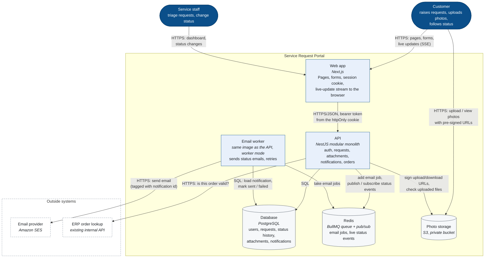
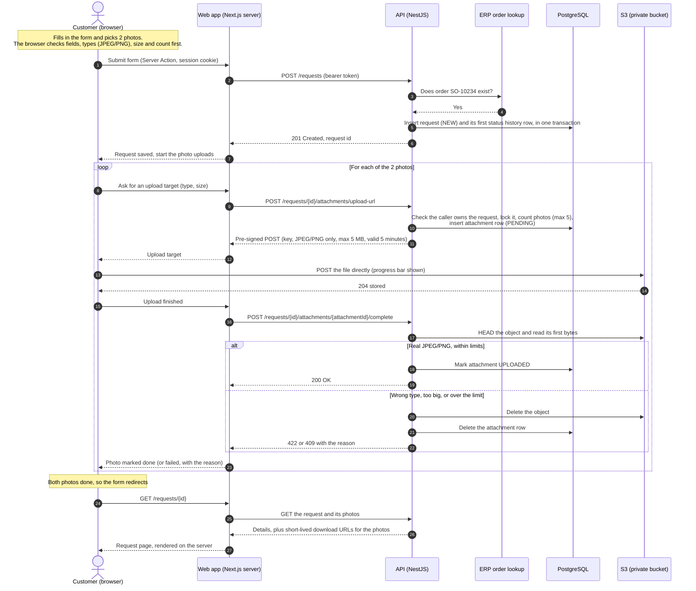
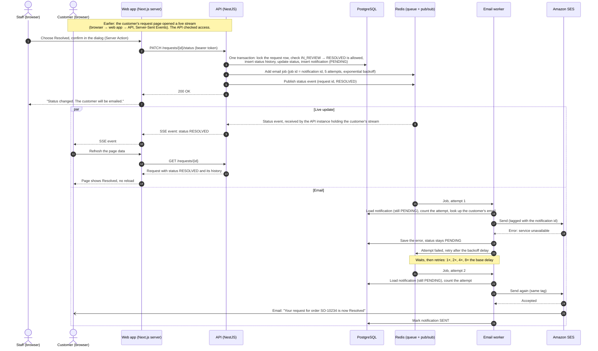
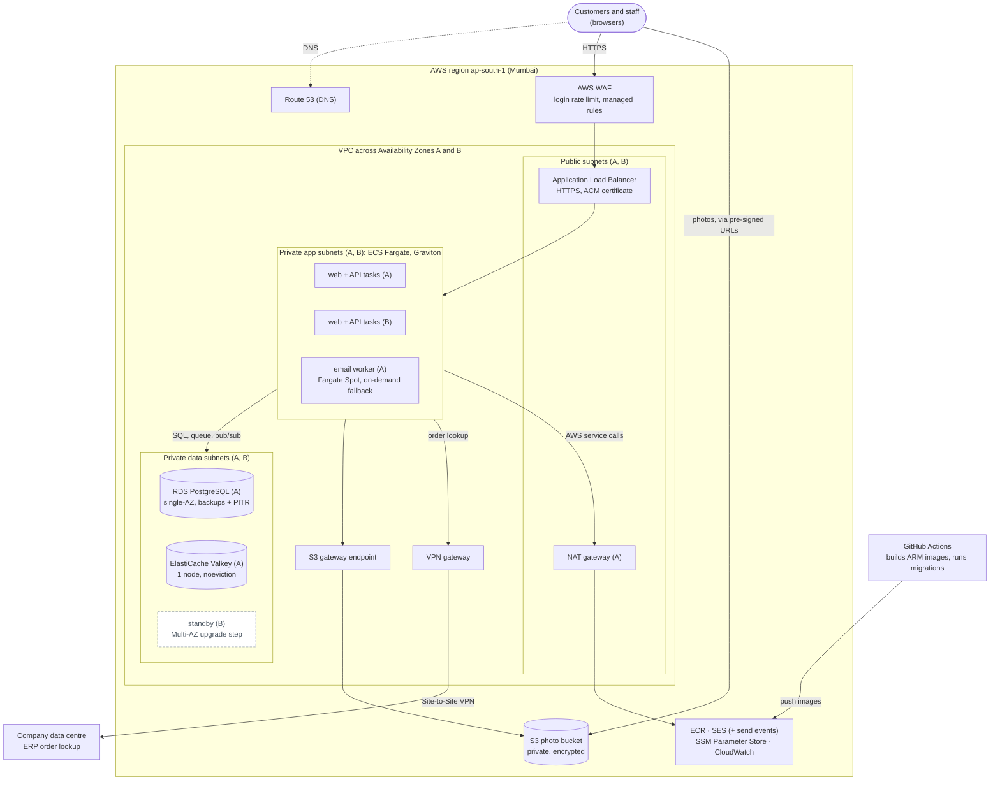

# Part D: Architecture and diagrams

## 1. Container diagram (C4 level 2)

- The API and the email worker are built from the same image but run as separate processes, so a slow email provider can't slow down API requests, and a crash in one doesn't take down the other.
- Photos never pass through our servers: the browser uploads and views them directly, with short-lived links the API signs.
- For live updates, the API publishes each status change on Redis, and whichever API instance holds the customer's open stream forwards it to the browser.

## 2. Sequence diagram: a customer submits a request with two photos

The request is saved first and the photos are attached after, so a failed photo never loses the request; the form just says which photo failed. How the upload links are limited and checked is covered in [Q4](#q4-photo-security).

## 3. Sequence diagram: staff resolve a request

The customer's page updates live, and the email goes out after one failed attempt and a retry.

- **No email is lost:** the status change and the email it owes are saved in one transaction (an outbox row). If Redis is down when the job is added, a sweeper re-queues unsent emails every 30 seconds.
- **No email is sent twice:** the job id is the notification id, so it can only be queued once, and the worker skips anything already marked sent. If an attempt ends unclearly (a timeout, or the worker crashing mid-send), the worker checks SES's send events for that notification's tag before trying again.
- **Failures are kept:** after 5 failed attempts the email is marked failed, and the job stays in the queue's failed list.
- **Live events only say "this request is now Resolved".** The page then reloads the full request with the normal access checks, so a missed event can't leave it wrong.

## 4. AWS deployment diagram

| Need | Choice | Why |
|---|---|---|
| Run web, API and worker | **ECS on Fargate** (ARM) | No servers to manage. Web and API run in both zones; the worker runs on Spot, since an interruption only delays an email. |
| Web app → API | **ECS Service Connect** | Only the web app calls the API, so the API stays private without a second load balancer. |
| Database | **RDS PostgreSQL**, small, single-AZ | Backups and point-in-time restore; a million rows a year is a light load. |
| Queue and live events | **ElastiCache for Valkey**, 1 node | BullMQ and pub/sub as today, set never to evict jobs. The outbox covers a node failure. |
| Photos | **S3**, private, encrypted | Reached privately through a free gateway endpoint. |
| Email | **Amazon SES** | Cheap and in-account; send events close the duplicate gap (see diagram 3). |
| ERP | **Site-to-Site VPN** | The ERP stays inside the company network. |
| Outbound traffic | **One NAT gateway** | If its zone fails, outbound calls pause and emails wait in the queue. |
| Edge protection | **AWS WAF** | Holds the login rate limit across all API tasks and blocks common attacks. |
| Secrets, logs | **SSM Parameter Store**, **CloudWatch** | Encrypted secrets at no cost; our JSON logs go straight in. |

**Cost:** about $190 a month at launch (around LKR 57,000). The savings come from redundancy, not security. At the national rollout, or once an hour of downtime becomes costly, the upgrade step is a Multi-AZ database and a Valkey replica: about $100 more a month, with no code changes.

## 5. Questions

### Q1. Service boundaries

**Why a modular monolith now?**
It's one app split into clear modules (auth, requests, attachments, notifications, orders), each owning its tables and talking to the others only through their services. At 300 requests a day, separate services would add deployments, network calls and monitoring for no gain. One database also lets a status change, its history and the email it owes be saved in a single transaction. And because the modules are already separate, splitting one out later is easy.

**When would I split out a service?**
When a module needs very different scaling, slows down or endangers the rest, is owned by a team that keeps blocking others' releases, or is needed on its own by other systems such as the ERP or a mobile app.

**Which module would go first?**
Notifications. It already runs as its own process behind a queue, owns its own table, and is the part most likely to grow (SMS, push notifications for a mobile app).

### Q2. Messaging: decision record

**Context:** a status change must trigger a customer email, with retries and exponential backoff, failed jobs kept, and no duplicates. Today the email worker is the only consumer, and we already run Redis for live updates.

**Options:**
- **BullMQ on Redis:** a job queue in our code, with retries, backoff, kept failures and duplicate protection built in.
- **SQS:** managed and durable, but exponential backoff needs extra code, and local runs need an emulator.
- **SNS:** sends one message to many places, but doesn't hold messages for a slow consumer.
- **EventBridge:** routes events to many systems by rules, with archive and replay.

**Decision:** BullMQ. With one consumer it covers every requirement out of the box, runs on the Redis we already have, and behaves the same locally as in production.

**Consequences:** Redis is set never to evict data. Even if Redis is lost, no email is, because each one is first saved in the database (the outbox) and re-queued from there. The downside is that other systems can't easily subscribe to these events.

**If the ERP and a mobile app needed these events too,** the answer changes. With several consumers, each needs its own retries, so a slow ERP never holds up emails. I'd publish one "request status changed" event from the outbox to EventBridge, with a rule (and usually an SQS queue) per consumer. A new consumer is then a new rule, not a code change, and replay lets us resend a day's events after an ERP outage. EventBridge beats SNS here for its routing rules, replay and cross-account delivery.

### Q3. AWS services

The services and the reason for each are in the table under the [AWS deployment diagram](#4-aws-deployment-diagram). The idea: managed services, sized for a few requests a minute, with every security piece in place and extra redundancy left as a later upgrade.

**Deliberately not chosen: EKS (Kubernetes).** For three small services, a Kubernetes cluster means a control plane to pay for, upgrades to run and tooling to learn. Fargate gives us the same containers, scaling and rolling deploys without any of that. It might make sense one day with many services and a team to run them; today it's cost and complexity we can't justify.

I also left out **Lambda** (it doesn't suit long-lived live-update connections or an always-on worker), **Aurora** (its fast failover and scale don't matter at this load, and it costs more) and **CloudFront** (one country, personal server-rendered pages and short-lived photo links leave little to cache).

### Q4. Photo security

**The bucket:** set up as code so the settings are reviewed and can't drift. Block Public Access is fully on, ACLs are off, every photo is encrypted at rest (SSE-KMS, so key use is logged), the bucket policy rejects anything not over HTTPS or not from our app's role, and CORS allows only our own site.

**Uploading:** for each photo the API issues a pre-signed upload valid for 5 minutes, for one exact path, JPEG or PNG only, up to 5 MB, and S3 rejects anything else. Afterwards the API checks the real file (size, type and first bytes) and deletes anything that isn't a genuine image.

**Viewing:** there are no public links. The API checks the viewer may see the request, then hands out download links that expire after 5 minutes. The app itself uses an IAM role limited to this bucket, over a private VPC endpoint, so no keys are stored anywhere.

**Auditing and retention:** CloudTrail records who opened which photo. Photos are personal data, so a lifecycle rule deletes them 2 years after upload, moves them to cheaper storage after 90 days, and cleans up unfinished uploads. The 2-year period is an assumption for the business and its legal team to confirm under Sri Lanka's data protection law.

### Q5. API security end to end

Most of this is already in the code.

- **Authentication:** passwords are scrypt hashes. Login returns a JWT that lasts an hour, kept by the web app in an httpOnly, Secure, SameSite cookie and sent to the API as a bearer token, which checks it on every call. Production adds MFA for staff and a way to end a session early.
- **Authorization:** every route declares its role, and a test fails if a new one doesn't. Anything about a specific request goes through one check: staff see all requests, customers only their own, and anyone else gets a 404 so ids can't be guessed.
- **Input validation:** unknown fields are rejected and every value is checked; photos are checked by S3 and again by the API.
- **Rate limiting:** 5 login attempts a minute per client, enforced in production by AWS WAF as well, so the limit holds across all API tasks.
- **Secrets:** nothing in the code or the browser. Production keeps them in Parameter Store, uses IAM roles instead of AWS keys, and rotates the JWT secret and database password.
- **Audit logging:** every status change records who made it and when. Logs are JSON with a correlation id, user id and role but no personal data, kept in CloudWatch, with CloudTrail for actions on AWS itself.

Every connection uses HTTPS, and the API isn't reachable from the internet at all.

### Q6. Observability

**Logs:** every request is logged as JSON with a correlation id, path, status, duration and the user's id and role, but no personal data. The email worker logs with the same correlation id, so one id follows a status change through to its email. In production they're searchable in CloudWatch Logs.

**Metrics:** AWS gives load balancer errors and response times, ECS CPU and memory, database load and storage, and Valkey memory. The app adds the email queue length, permanently failed emails, the age of the oldest unsent email, open live-update connections and failed logins. The `/health` endpoint lets ECS replace a broken task.

**Traces:** OpenTelemetry to AWS X-Ray, showing where the time goes as a request passes through the web app, API, database, Redis, S3 and SES. Sampling about 10% keeps it cheap.

**The first three alerts:**
1. **The portal is failing:** over about 2% server errors for 5 minutes, or unhealthy tasks.
2. **The portal is slow:** the API's 95th-percentile response time above 1 second for 10 minutes, which would catch a Part C-style slowdown early.
3. **Emails aren't going out:** the oldest unsent email is over 15 minutes old, or any email has failed for good. Retries are silent, so without this a broken email setup could go unnoticed for days.

Alerts go from CloudWatch to whoever is on call, by email or Slack.

### Q7. Growth

At ten times the load (about 3,000 requests a day) traffic is still a few page loads a minute, so nothing breaks from load. What changes is the amount of data and the cost of an outage.

1. **The staff dashboard slows down.** A million rows a year makes page numbers and exact counts slow; it's the Part C problem. The fix is keyset paging and the partial index from [DATABASE.md](DATABASE.md), and the code already marks this upgrade.
2. **Downtime matters more.** After the national rollout, the single-AZ database and single Valkey node become the weak spots, so we take the upgrade step: Multi-AZ and a replica, about $100 more a month.
3. **Email limits.** About 250,000 emails a month is above what a new SES account allows, so we request production access and a higher quota before the rollout.
4. **Worth watching:** database connections as API tasks grow (RDS Proxy if needed), the single shared live-update channel (fine at ten times), and photo storage (capped by the 2-year rule).

What I wouldn't change: no microservices, no Kubernetes, no bigger database engine. Even at ten times, the current design fits.
